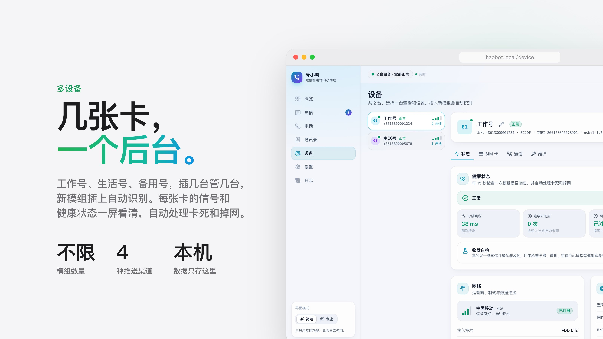

# 号小助（haobot）

[English](README.en.md)


你的短信和电话小助理：守着插在蜂窝模组（目前支持 Quectel EC20，其他移远、SIMCom 型号可以识别但没在真机上测过）里的号码，收短信、用大模型自动分类；来电由 AI 先接听，问清来意，再把短信和通话小结推送给你（Telegram、飞书、钉钉、企业微信）。

`haobot-agent` 是一个单独的程序，支持 macOS 和 Linux（包括 NAS），连接模组，把短信和通话存进本机的 SQLite 数据库，自带一个带登录的网页管理后台。可以同时管理多台模组：短信按“设备 + 号码”汇总成会话，可以直接回复；可以在网页上用模组里的 SIM 卡打电话、接电话。




<sub>以上截图中的号码、短信和通话均为演示用的虚构数据。</sub>

> **使用须知**
>
> - 只在你自己的号码上使用。不要用来群发短信、骚扰他人，或接收不属于你的短信。
> - **通话录音**：很多地区要求录音前告知对方。默认只录 AI 接听的通话，可以在设置里关闭。
> - **AI 接听**：默认不主动说自己是 AI，对方认真问时会如实回答。有些地区要求 AI 接听电话时主动表明身份，请在“设置 → AI 接听”里打开“接通后主动说明自己是 AI”。
> - **数据去向**：短信脱敏后发给你配置的大模型做分类；AI 接听时通话声音会实时发给阿里云百炼；推送的内容会经过对应平台的服务器。其余数据只存在本机。
> - 本项目按 MIT 许可证提供，不附带任何担保。因使用本软件产生的费用（短信、通话、大模型调用）和后果由使用者自行承担。

## 需要准备什么

- **蜂窝模组**：Quectel EC20（推荐带 USB 转接板的版本，例如 mini PCIe 转 USB 的开发板），插上能正常上网的 SIM 卡。要打电话或用 AI 接听，模组和 SIM 卡都要支持 VoLTE。
- **一台常开的电脑**：macOS，或 Linux（x86_64 / arm64，树莓派、NAS 都可以）。
- **（可选）大模型 API Key**：短信分类支持任何 OpenAI 兼容接口或 Anthropic；AI 接听需要阿里云百炼的实时语音模型。

## 快速开始

插上模组，在 Linux 或 macOS 的终端里执行：

```sh
curl -fsSL https://raw.githubusercontent.com/f0rmatting/haobot/main/scripts/install.sh | sh
```

脚本会自动识别系统和 CPU 架构，从 [Releases](https://github.com/f0rmatting/haobot/releases) 下载对应的程序、校验 SHA256，放到 `/usr/local/bin`（没有写权限时放到 `~/.local/bin`），然后问你要不要现在启动：

- 选择启动后会再问一句“允许局域网里的其他电脑、手机打开管理后台吗”。NAS、树莓派这类没有屏幕的机器选 `y`。
- 启动后终端会显示管理后台的地址和首次登录密码（用户名 `admin`）。浏览器打开后会提示证书不受信任，点“高级 → 继续访问”即可，原因见下文“HTTPS”。
- 在“设置”里配置智能分类（大模型）、消息推送和 AI 接听，都可以先点“测试”确认能用。

号小助在后台运行，关掉终端也不会停。之后用这几个命令管理，详见下文“后台运行”：

```sh
haobot-agent start        # 启动（第一次可以加 -lan 允许局域网访问，参数会被记住）
haobot-agent status       # 是否在运行、管理后台地址
haobot-agent stop         # 停止
```

- **升级**：再执行一次上面的安装命令。正在运行的号小助会先停下，换成新版本后按原来的参数重新启动，短信和设置都保留。
- **网络慢**：国内连 GitHub 慢的话，可以用 `HAOBOT_MIRROR` 指定 GitHub 下载加速前缀，或用 `HAOBOT_VERSION=v1.2.3` 跳过查询最新版本。也可以从 Releases 手动下载，解压后运行 `./haobot-agent start`。
- **Linux 权限**：普通用户运行时，需要在 `dialout` 组里才能读写模组串口（Arch 是 `uucp`），安装脚本发现缺少权限时会提示命令。详见下文“后台运行”。
- **卸载**：`haobot-agent stop`，然后删掉程序文件即可。数据在 `~/.haobot`，不要了也一并删掉。

- **多设备**：自动发现所有已知型号的模组（插上即用，拔掉自动移除），每台按 IMEI 区分，可以在后台改名、停用。也可以用 `-device` / `-usb-location` 指定端口。
- **macOS**：通过 libusb 直接读写模组的 USB AT 口，不用装驱动（macOS 没有 EC20 的驱动，不会生成 `/dev/cu.*`）。多台同型号模组按 USB 端口位置区分。
- **Linux**：默认使用内核 `option` 驱动生成的 `/dev/ttyUSB*`，通过 sysfs 找到每台模组的 AT 口；也可以改用 libusb。
- **存储**：SQLite（`modernc.org/sqlite`，纯 Go），默认放在 `~/.haobot/haobot.db`。
- **管理后台**：React 单页应用，编译进二进制。详见下面的“管理后台”一节。

## 管理后台

浏览器打开 Agent 的监听地址（默认 <https://127.0.0.1:9081>，第一次打开浏览器会提示证书不受信任，见下文“HTTPS”）。界面支持深色和浅色主题，也适配手机屏幕，通过事件流（SSE）实时刷新。右上角或侧栏可以在两种模式之间切换：

- **简洁模式**：只显示日常功能，出问题时概览页会给出说明和一键处理按钮（输入 PIN、关闭飞行模式等）。
- **专业模式**：额外显示 AT 控制台、LTE 服务小区参数（RSRP/RSRQ/SINR）、网络制式锁定、IMSI 和短信中心、原始数据、脱敏预览，以及分类类别编辑。

| 页面 | 功能 |
|---|---|
| 概览 | 运行状态、待处理问题、信号表盘、短信统计、分类分布、最新短信 |
| 短信 | 按“设备 + 号码”汇总成会话：列表显示号码、所属设备、最新一条摘要和未读数；会话里以聊天气泡显示往来记录，可直接回复（显示发送中/已发送/失败，失败可重发）；可以新建短信并选择用哪张卡发送；搜索、按设备/分类/未读筛选，验证码一键复制，改分类、删除单条或整个会话 |
| 设备 | 多台设备切换；改名、停用、移除离线设备；网络与数据连接、SIM 卡（解锁 PIN、PUK 解锁、开关 PIN 锁、改 PIN）、飞行模式、重启模组；专业模式下有网络制式和 AT 控制台 |
| 设置 | 后台密码、SIM 自动解锁（PIN 加密保存）、智能分类（服务商、模型、API Key、测试连接、脱敏试运行、类别编辑、全部重新分类）、界面偏好 |
| 日志 | 连接、SIM、同步、AI 接听、推送和后台操作的记录（保留最近 10000 条），按天分组，可按级别、设备和关键词筛选，分页查看 |

设备操作和短信同步在同一条 AT 连接上排队执行，不会互相干扰。可能消耗 SIM 卡最后一次 PIN 机会的操作会被拦下，必须再确认一次。

### 智能分类

每条新短信都会被分到一个类别：验证码、账单交易、快递物流、营销推广、推销骚扰、运营商、通知提醒、个人消息、其他。专业模式下可以修改类别。

分类**完全由大模型完成**，没有本地规则：

1. 每条文字短信（包括验证码短信）先在本机**脱敏**，再发给大模型判断类别。支持 OpenAI 兼容接口（DeepSeek、通义千问、智谱、Kimi、本地 Ollama 等）和 Anthropic 原生接口。验证码、取件码、密码、证件号、银行卡号、卡号或账户尾号、订单号、手机号、座机、邮箱、账号、车牌、IP、地址门牌、姓名、金额、链接参数和 4 位以上数字都会被替换成占位符，个人手机号发件人也会被隐去，`【签名】`和日期保留。“设置 → 智能分类 → 隐私保护”里的“试一试”可以看到模型实际收到的内容。
2. 二进制数据短信没有文字内容，固定归为“其他”；彩信只收到通知、看不到内容，而且基本都是广告，固定归为“营销推广”。这两种不调用大模型。
3. **未启用或没配置好大模型时**，新短信保持“待分类”，概览页会提醒；配置好后自动补上分类。

分类失败（网络、额度等原因）时，短信保持“待分类”，后台会退避重试；修改设置后立即重试。手动改过的分类不会被“重新分类”覆盖。

每一次判定都有记录，可以在两个地方查看：会话里点短信旁的“…”→“分类依据”，或“设置 → 智能分类 → 分类调用记录”（可按大模型、手动、失败筛选，保留最近 2000 条）。大模型会显示服务、模型、请求地址、耗时、置信度、实际发出的脱敏内容、系统提示词和模型的原始回复，失败时显示错误原因。

SIM PIN 和 API Key 用 AES-256-GCM 加密后存进数据库，密钥是数据目录里的 `secret.key`（权限 600）。页面上永远不会显示原文。

## 编译

macOS 需要 libusb 和 pkg-config：

```sh
brew install libusb pkg-config
make build            # 生成 bin/haobot-agent
make test
```

Linux 静态二进制（不依赖 cgo，只能用 serial 方式）：

```sh
make linux            # 生成 bin/haobot-agent-linux-amd64 和 bin/haobot-agent-linux-arm64
```

如果 Linux 上也想用 libusb 方式，就在 Linux 本机装好 `libusb-1.0-0-dev` 后执行 `make build`。

发布用的压缩包（含程序、许可证和说明文档）：

```sh
make dist VERSION=v1.2.3   # dist/ 下生成 Linux amd64、arm64、armv7，在 Mac 上还会生成本机架构的 macOS 版
```

在 GitHub 上推送 `v` 开头的标签（例如 `git tag v1.2.3 && git push origin v1.2.3`）会自动测试、编译 5 个平台（Linux amd64/arm64/armv7、macOS Apple 芯片/Intel），附上校验和发布到 Releases；带 `-` 的标签（如 `v1.2.3-rc.1`）发布为预发布版本。macOS 版把 libusb 静态编译进程序，不需要 Homebrew。

管理后台的源码在 `ui/`（React + Vite + TypeScript + Tailwind），编译结果放在 `internal/agent/web/dist` 并提交进仓库，所以只改 Go 代码时不需要 Node。改了前端后：

```sh
make ui               # 需要 Node 和 pnpm，编译到 internal/agent/web/dist
make build
make ui-dev           # 开发模式：热更新，/api 代理到 127.0.0.1:9081 上运行的 Agent（端口可用 HAOBOT_PORT 改）
```

## 运行

```sh
./bin/haobot-agent serve
```

首次启动会在终端（或日志）里打印一次随机生成的网页登录密码，用户名固定为 `admin`。之后可以修改：

```sh
./bin/haobot-agent passwd
```

然后打开 <https://127.0.0.1:9081>。

常用参数（完整列表见 `haobot-agent serve -h`）：

| 参数 | 默认值 | 说明 |
|---|---|---|
| `-listen` | `127.0.0.1` | 只允许本机访问。局域网访问改成 `0.0.0.0`。也可以写成 `0.0.0.0:9081`，连端口一起指定 |
| `-port` | `9081` | Web 端口，也可以用环境变量 `HAOBOT_PORT` 指定。同时给了 `-listen 地址:端口` 时，以 `-port` 为准 |
| `-data` | `~/.haobot` | 数据目录，也可以用环境变量 `HAOBOT_DATA` 指定 |
| `-transport` | macOS 为 `usb`，Linux 为 `serial` | 连接方式 |
| `-device` | 空（自动发现） | serial 方式使用的 AT 串口，多个用逗号分隔 |
| `-audio-device` | 空（Linux 自动查找） | serial 方式的通话音频串口，与 `-device` 一一对应 |
| `-usb-location` | 空（自动发现） | usb 方式的 USB 端口位置（如 `1-1.2`），多个用逗号分隔 |
| `-usb-interface` | `2` | usb 方式使用的 AT 接口号（EC20 的 2、3 号接口都是 AT 口） |
| `-storage` | `ME` | 新短信的接收存储：`ME`（模组）或 `SM`（SIM 卡） |
| `-scan-storages` | `ME,SM` | 每次同步都会读取的存储，模组和 SIM 卡上的短信都会收进来 |
| `-delete-after-save` | 开启 | 入库后从模组/SIM 卡删除。要保留就用 `-delete-after-save=false` |
| `-keep-binary` | 关闭 | 保存二进制短信。默认直接丢弃（彩信通知不受影响） |
| `-poll` | `30s` | 状态刷新和兜底扫描的间隔 |
| `-tls` | 开启 | 用 HTTPS 提供 Web，同一端口的 `http://` 请求自动跳到 `https://`。放在反向代理后面时用 `-tls=false` 关闭 |
| `-tls-cert`、`-tls-key` | 空（自动生成） | 用自己的证书（PEM），两个一起指定 |
| `-secure-cookie` | 关闭（`-tls` 开启时自动开启） | `-tls=false` 并通过 HTTPS 反向代理访问时打开 |

## 多台设备

不指定 `-device`、`-usb-location`、`-usb-vid`、`-usb-pid` 时，Agent 每 5 秒查找一次已知型号的模组，新插入的自动连接，拔掉的自动移除。已知型号：Quectel EC20/EC25/EG25、EC21、EG91/EG95、BG96，SIMCom SIM7600（**只有 EC20 在真机上测试过**）。

- 每台设备用 IMEI 标识，默认名称是“型号-IMEI 末 4 位”，可以在后台改名。停用的设备保持连接，但不读取新短信、不能发短信。
- 短信、会话、SIM 自动解锁的 PIN 都按设备区分。命令行或环境变量提供的 PIN 对所有设备生效。
- 调试命令 `haobot-agent at` 在只找到一台模组时直接使用它，找到多台时会列出来让你用 `-device` 或 `-usb-location` 选择。

## 健康检查与自动恢复

设备页的“健康状态”面板显示每台设备是否真正在工作。程序会做下面几件事：

| 检查 | 做法 | 出问题时 |
|---|---|---|
| 心跳 | 每 15 秒（以及每次轮询前）发一次 `AT`，记录响应时间；任何指令超时后立即再检查，每秒一次 | 连续 3 次不响应判定为卡死，断开重连 |
| 卡死升级 | 15 分钟内卡死两次 | 重连成功后软重启模组（`AT+CFUN=1,1`） |
| 彻底无响应 | 重连后仍连续 2 次不响应 AT | USB 复位（相当于拔插一次） |
| 网络 | SIM 卡正常但没注册到网络 | 10 分钟后开关一次射频重新搜网，20 分钟后软重启 |
| 收发自检 | 手动点“立即自检”，给指定号码（默认本机号码，也可以是另一台设备）发一条带随机编号的短信，3 分钟内收到算通过 | 显示失败原因；测试短信收到后自动删除，不参与分类 |

- 软重启和 USB 复位每台设备每小时最多 3 次，超过后暂停自动处理并在概览页告警，处理完点“恢复自动处理”。重连不限次数。
- 每台设备可以关闭“自动恢复”，关闭后卡死时只告警。
- 收发自检会产生一条短信费用，只在手动点击时发送。
- USB 复位：macOS 通过 libusb；Linux 串口方式通过 usbfs，需要对 `/dev/bus/usb` 有写权限（root，或装上 `haobot-agent udev-rules` 输出的规则并加入 `plugdev` 组，见“后台运行”）。复位失败会记录原因，程序继续尝试重连。
- 最近的自动恢复记录在设备页显示（重启 Agent 后清空），完整记录在“日志”页。
- 外部告警（推送到手机等）还没做，目前只在管理后台显示。

### 大模型不可用时

收短信、推送、来电提醒和未接来电不依赖大模型。大模型连不上（欠费、限流、网络故障、百炼出问题）时，这些照常工作，只是少了 AI 的部分：

| 功能 | 大模型不可用时 |
|---|---|
| 短信推送 | 一次分类失败后，新短信不再等分类（平时最多等 20 秒），收到就推送。推送规则里“还没分好类的”需要勾选，否则这段时间的短信不会推送 |
| 短信分类 | 短信先标为“待分类”，后台按 1 分钟到 15 分钟逐步拉长间隔重试，每来一条新短信也会立刻重试一次。恢复后自动补上分类，日志里记一条“短信分类已恢复” |
| AI 接听 | 电话开始响铃时就去连 AI 模型，连好了才接。连不上（或响铃等待结束后 8 秒还没连上）就不接，电话照常响铃，没人接就是普通的未接来电，照常推送并进入“待回电” |
| 通话小结 | 失败先重试一次。还不行，小结里放对方说过的原话，标为建议回电，照常推送 |

单次分类请求最多等 15 秒。

## 电话

“电话”页可以用模组里的 SIM 卡拨打和接听电话，声音走这台电脑的麦克风和扬声器（建议戴耳机）。

- **来电**：任何页面都会弹出来电提示并响铃，标签页标题闪烁；可以接听或拒接。
- **通话中**：底部浮条显示号码、设备、通话时长和声音状态，可以静音、打开拨号盘按键（DTMF）、挂断。如果电话不是从这个页面接起的，可以点“接入声音”。
- **通话记录**：来电、去电、未接、已拒接、未接通，以及通话时长，按设备区分；可以回拨、发短信、删除。未接来电会在导航栏显示红色角标。
- **呼叫转移**：设备页可以查询和设置无条件、遇忙、无应答、无法接通四种转移，由运营商执行，不需要网页在线。部分运营商的 VoLTE 网络不支持用 AT 指令设置，这时请用手机或客服设置。
- 会话页的个人号码旁有拨号按钮。

工作原理和要求：

- 需要模组支持 VoLTE（国内 2G/3G 正在退网）。可以在 AT 控制台执行 `AT+QCFG="ims"`，第二个数为 `1` 表示 VoLTE 已就绪。
- 声音通过移远 `AT+QPCMV=1,0` 走 USB 的 NMEA 口（EC20 的 1 号接口），格式是 8kHz、16 位、单声道 PCM；浏览器通过 WebSocket 收发，自己做采样率转换。macOS 上复用同一个 USB 连接，Linux 上通过 sysfs 自动找到对应的 `/dev/ttyUSB*`，也可以用 `-audio-device` 指定。
- 浏览器只允许在 `localhost` 或 HTTPS 下使用麦克风；其他方式访问时只能听不能说。
- 音质是普通电话的窄带水平。局域网内延迟大约一两百毫秒。同一张卡同一时间只能有一通电话，通话期间短信照常收发。
- 程序每 20 毫秒向模组写一帧上行声音，没有麦克风数据时补静音：`AT+QPCMV` 需要稳定的上行，否则下行会断断续续。写入偶尔超时的帧会被跳过，不会中断节拍。
- EC20 偶尔会在 USB 上多发或少发一个字节，之后每个 16 位采样都会错位，人声变成很响的“爆破音”。程序按声音内容检测这种错位（语音平滑、错位后粗糙），连续 3 帧确认后丢弃 1 个字节恢复对齐，日志的通话音频统计里会显示“字节对齐修正 N 次”。
- 排查音质：每通电话结束后，“日志”页有一条“通话音频统计”（下行字节/秒正常约 16000、最长中断、补静音帧数等）；通话中浮条下方实时显示这些数字。加上 `-debug-call-audio` 启动，会把每通电话的原始音频存到数据目录的 `audio-debug/` 下（8kHz、16 位、单声道小端 PCM，可用 Audacity 按“原始数据”导入）。
- 来电靠模组的 `RING` 通知立即发现。有的 EC20 出厂把这类通知发往 modem 口（接口 3），程序连上时会用 `AT+QURCCFG="urcport","usbat"` 改到正在使用的 AT 口，并在日志里记一条；另外空闲时每 3 秒查一次通话列表兜底。
- `AT+CLCC` 在 EC20 上会把数据连接也列成"通话"（第四项为 `1`），程序只处理语音通话（第四项为 `0`）。

## AI 接听助手

“设置 → AI 接听”打开后，来电响铃一段时间（默认 10 秒）还没人接，就由 AI 接听：它像平常人接电话那样说开场白（默认不主动介绍自己是助理或 AI；打开“接通后主动说明自己是 AI”后，说完开场白会表明身份），问清楚对方是谁、什么事、急不急、要不要回电，然后道别并挂断。对方认真问它是不是真人、是不是 AI 时，它会如实回答一句，然后继续问来意；它也不会冒充你本人。挂断后用文本模型写一份小结，存在通话记录里（带“AI 接听”标记，导航栏角标会提醒），概览页也会显示最近三天的 AI 接听。

- **响铃期间**：来电弹窗显示倒计时，可以自己接、拒接、点“不用 AI”，或“现在接”让 AI 立即接听。没开自动接听时，弹窗里也有“交给 AI”。
- **AI 通话中**：浮条上实时显示双方说的话。“旁听”可以听到双方的声音（对方听不到你）；“我来接”把电话接过来，之后就是普通通话；也可以直接挂断。对方插话时 AI 会立即停下来听。
- **安全**：AI 不替机主做承诺、不透露个人信息；遇到索要验证码、转账、自称公检法/客服退款的电话会拒绝并结束。可以在“补充说明”里告诉它怎么应对常见来电（例如“快递放门口”）。对方 30 秒不说话、或者通话快到上限（默认 3 分钟）时会道别挂断。
- **模型和接口**：在设置里选实时语音模型（默认 `qwen3.8-omni-flash-realtime`，也可以选 Qwen3.5 Omni Plus/Flash、Qwen3 Omni Flash 或填写其他模型名），声音列表会跟着模型变化。接口地址可以“跟随智能分类”（由那里的百炼 Base URL 推算），也可以选新加坡或北京并填写业务空间 ID（`wss://<业务空间ID>.<地域>.maas.aliyuncs.com/api-ws/v1/realtime`），或者完全自定义。API Key 可以单独填写（不同地域的 Key 不通用），留空就用“智能分类”里的。通话后的小结用“智能分类”里配置的文本模型。保存前可以点“测试连接”。
- **语速**：实时语音模型没有语速参数，程序在本机用保持音调的变速算法（WSOLA）加快 AI 的声音，默认 1.1 倍，可选原速到 1.3 倍。
- **防止恶意消耗 Token**：AI 只负责记录来意，闲聊、百科问答、写作翻译、讲故事、角色扮演、让它忽略规则或打听提示词等一律拒绝，再纠缠就道别挂断。另有硬性上限（都可以在设置里改）：24 小时内最多由 AI 接听 20 通、同一号码最多 3 通（超过后按普通来电响铃，并在日志里说明）；每通电话最多回复 12 次、最长 3 分钟，快到时 AI 主动道别；每次回复最多约 30 秒；对方 30 秒不说话就挂断。
- **录音和文字记录**：AI 接听的通话保存双方的文字记录和小结；录音默认只录 AI 接听的通话，也可以选“所有通话”或“不录音”。录音是 8kHz 单声道 WAV（双方混在一起，约 1MB/分钟），保存在数据目录的 `recordings/` 下，在“电话”页和概览页可以直接播放、拖动、下载；删除通话记录时一起删除，超过保留天数（默认 90 天）自动删除。录音前请留意当地法律对告知对方的要求。
- **隐私**：通话声音会实时发给百炼，无法像短信那样先去掉敏感信息；文字记录和小结只存在本机数据库。
- 电话声音是 8kHz。程序优先请模型直接用 8kHz 收发（带宽只有 24kHz 的三分之一），模型不支持时改用 16kHz 输入、24kHz 输出，并在本机做重采样和低通滤波。“测试连接”会显示实际用的格式。
- AI 的每段话先缓冲约 0.3 秒再播放；如果中途没跟上，缓冲自动加长（最多 2 秒），宁可开口前多等一下也不一顿一顿。每通电话后日志会记一条“AI 语音：…到达速度 N 倍实时”，低于 1.3 倍说明到百炼的网络太慢（例如经代理访问新加坡），会提示换地域或调整网络。

## 概览页

- 顶部是运行状态、三个功能（智能分类、AI 接听、消息推送）的开关状态和时钟，下面一句话总结今天：收到多少短信（其中验证码、营销骚扰各几条）、几个来电、AI 接了几个、几个等你回电。
- **待回电**：最近 3 天的未接来电，以及 AI 小结里写了需要回电的来电，同一号码只列最新一次。可以直接回拨或发短信；之后回拨过这个号码、接过它打来的电话，或者点“已处理”，它就会消失。
- 指标卡、24 小时 / 7 天活动趋势（带刻度）、设备信号（信号弱时给出调整建议）、AI 代接小结（一行一条，点开看详情）。
- **实时动态**把新短信、来电、AI 接听和系统警告按时间排在一起；模组重连这类例行记录只在日志页显示。

## 消息推送

“设置 → 消息推送”把新短信、来电提醒、未接来电和 AI 接听小结推送给你。支持 Telegram、飞书、钉钉、企业微信，可以同时开启多个，每条消息发到所有开启的渠道；每个渠道单独排队、单独重试，一个不通不影响其他。

**推送渠道**

- **Telegram**：在 @BotFather 发送 `/newbot` 创建机器人，复制 Bot Token；打开机器人发送 `/start`（群组就把机器人拉进群并发一条消息）；填入 Token，点“获取”自动找到 Chat ID。国内网络需要能访问 `api.telegram.org`，可以填代理（`socks5://127.0.0.1:7890` 或 `http://…`），专业模式下也可以改成自建的 Bot API 地址。
- **飞书**：群聊右上角“更多 → 设置 → 群机器人 → 添加机器人”，选“自定义机器人”（找不到这一项通常是企业管理员关闭了），复制 Webhook 地址。安全设置建议用“签名校验”并填入密钥；用“自定义关键词”的话填“号小助”（每条消息末尾都带这三个字）。
- **钉钉**：群设置 → 机器人 → 添加“自定义”机器人，复制 Webhook 地址。安全设置建议用“加签”并填入 SEC 开头的密钥，或者关键词填“号小助”。每个机器人每分钟最多 20 条。
- **企业微信**：群聊右上角 → 添加群机器人 → 新创建，复制 Webhook 地址。每个机器人每分钟最多 20 条。

填好后点“发送测试消息”确认能收到。Bot Token、Webhook 地址（里面带有机器人的密钥）和签名密钥都加密保存在本机，页面只显示末尾几位，错误信息里也不会出现。

**推送内容**（对所有渠道生效）

- **短信**：勾选要推送的类别，每个类别都附带说明；可以一键选“全部”“不要广告和推销”“只要验证码”。“还没分好类的”指智能分类没开、出错或 20 秒内没有结果的短信。以后新加的类别默认推送。智能分类开着时，等分类完成（最多 20 秒）再推送；验证码单独列出方便复制，也可以选择隐藏。
- **电话**：来电提醒默认关闭，未接来电和 AI 接听小结（来电者、来意、紧急程度、是否回电）默认打开。AI 接听小结可以按来电类别选择推送（快递外卖、工作、家人朋友、商务合作、客服通知、推销广告、疑似诈骗、其他），一键“不要推销和诈骗”；AI 判断为紧急的来电默认不管类别都推送。不推送的小结仍保存在“电话”页。

网络不通或被限流时自动重试几分钟，失败和恢复会记在日志里。推送的短信原文会经过对应平台的服务器。

## 发短信和回复

在会话里直接回复，或点“新短信”选择设备、填写号码。

- 中文按 UCS-2 编码，每条 70 字；超过时分段发送（每段 67 字），对方手机会自动合并，最多 10 段。纯英文和数字按 GSM 7-bit 编码，每条 160 字。输入框下方会显示预计条数。
- 国内号码直接填（按“未知类型号码”发送）；国际号码以 `+` 和国家码开头。`+86 138…`、`86138…`、`138…` 会归到同一个会话。
- 发送是异步的：先显示“发送中”，模组确认后变成“已发送”（已提交给运营商，不代表对方已收到），失败会显示原因并可以重发。程序重启时还没发完的消息会标为失败。
- 回复 106、95 开头等服务号码时，页面会提醒：这类号码很多不接收回复，或会按增值业务收费。

## 通讯录和黄页

“通讯录”页面管理两份电话本：

- **我的联系人**：私有电话本，只保存在本机的数据库里，可以上传头像（在浏览器里裁成正方形并压缩后上传）。在短信会话或通话记录上点“加入通讯录”也能添加。
- **黄页**：内置约 300 家银行、快递、运营商、政府机构等的客服号码和 logo，数据来自 [metowolf/vCards](https://github.com/metowolf/vCards)（MIT），随版本更新。logo 是各机构的商标，仅用于识别来电和短信。可以修改内置机构的名称、分类、号码和 logo，删除不想要的机构，也可以新建自己的机构（如小区物业、某个 1069 营销号）。这些修改单独保存在本机数据库里，叠加在内置数据之上：没改过的机构照样随版本更新，改过的可以一键恢复成内置的样子。

两份电话本都能导入、导出：联系人用 vCard（`.vcf`），可以和 iPhone、安卓、Google 通讯录互相导入（一个人有多个号码时按号码拆成多个联系人；号码已存在时默认跳过，可选覆盖）；黄页导出为 JSON，包含你的修改和自定义 logo，可以导入另一台号小助。

短信、通话记录、来电弹窗和推送通知会显示号码对应的名字和头像，自己的联系人优先于黄页；联系人没有头像时用黄页里这个号码的 logo。

号码不在黄页里的短信，会按开头或结尾的签名（如【招商银行】）匹配黄页机构，显示它的 logo，不改名字，也不会加入通讯录。签名谁都能打，所以只对 106、95 这类服务号码发来的短信生效；个人手机号发来的“【招商银行】……”不会显示 logo，以免让钓鱼短信看起来像真的。`+86`、空格、横杠写法不同的同一号码都能匹配；95/96 开头的服务号码，扩展号（如 955880）也会归到主号码。

维护者更新黄页数据：`make yellowpages`，然后提交 `internal/agent/phonebook/yellowpages.json` 和 `logos/`（logo 缩到 96px，约 1MB）。

## 短信是怎么收的

1. 初始化时设置 PDU 模式、存储位置，以及 `AT+CNMI=2,1,0,0,0`：新短信先存进模组，再上报 `+CMTI`。
2. 收到 `+CMTI` 后，立即依次读取 `-scan-storages` 里的每个存储（默认是模组 `ME` 和 SIM 卡 `SM`）；另外每隔 `-poll` 时间再扫一遍，防止漏掉上报。
3. 每条 PDU 按哈希去重后入库。长短信等所有分段到齐后再拼接；超过 2 小时还没到齐，就以"不完整"状态入库，缺的分段显示为 `[缺失分段]`。
4. **入库成功后，从模组/SIM 卡里删除这条短信**，避免存储被占满。删除一定在写入数据库之后。
5. 8 位编码的二进制短信（多见于 1064 物联网号段，是机器数据，不是文字）默认**不入库**，在事件记录里留一行，然后从模组里删除。如果要保留，加上 `-keep-binary`，保留下来的会以十六进制显示。之前已经入库的二进制短信，可以用 `haobot-agent purge-binary` 删除。

注意：读取短信会把模组里的未读短信标记为已读。

## 彩信

彩信不是直接通过短信送达的。运营商先发一条 **WAP Push 短信**（二进制格式，目标端口 2948），里面是一个彩信通知（`m-notification-ind`），说明发件人、主题、大小、下载截止时间和内容地址。图片、文字等真正的内容仍然放在运营商的彩信中心（MMSC）上。

目前的处理方式：

- 识别彩信通知，以“彩信”条目入库，显示主题、大小和下载截止时间，固定归为“营销推广”（个人号码收到的彩信基本都是广告）。彩信通知不会被当成二进制短信丢掉。
- **不下载彩信内容。** 下载要让模组用运营商的彩信 APN（比如联通是 `3gwap`，代理 `10.0.0.172:80`）访问 MMSC，各运营商设置不同，大的彩信还会占用模组几十秒，所以暂时没有做。
- 彩信内容在运营商那边有有效期，一般是几天，过期就下载不了。

## SIM 卡 PIN

默认不自动输入 PIN。SIM 卡被锁时，概览页会提示，并可以直接在页面上输入 PIN。要自动解锁，最简单的方法是在管理后台“设置 → SIM 卡”里保存 PIN。也可以用下面三种方式之一提供 PIN，它们的优先级高于后台里的设置：

```sh
# macOS 钥匙串（推荐）
security add-generic-password -s haobot-pin -a haobot -w   # 按提示输入 PIN
./bin/haobot-agent serve -sim-pin-keychain haobot-pin

# 文件（Linux 推荐，权限设为 600）
./bin/haobot-agent serve -sim-pin-file /etc/haobot/pin

# 环境变量
HAOBOT_SIM_PIN=1234 ./bin/haobot-agent serve
```

为了防止把卡锁死，自动解锁有两条限制：

- 只有剩余次数是满额的 3 次（`AT+QPINC`）时才会尝试。
- 只要失败一次就不再尝试，直到在后台手动解锁或更新保存的 PIN。

所以配错的 PIN 最多消耗一次机会，而且只在剩余次数是满额时才会发生。

## 后台运行

`haobot-agent serve` 在前台运行，适合调试，按 Ctrl+C 停止。日常使用推荐 `start`：

| 命令 | 说明 |
|---|---|
| `haobot-agent start [参数]` | 在后台启动，关掉终端也继续运行。参数和 `serve` 相同，另外 `-lan` 等于 `-listen 0.0.0.0`。启动成功后显示管理后台地址；第一次启动还会显示登录密码 |
| `haobot-agent status` | 是否在运行、进程号、管理后台地址。没在运行时退出码为 3，方便脚本判断 |
| `haobot-agent stop` | 停止，等它把数据库写完再退出 |

- **参数会被记住**：带参数的 `start` 会把参数存到数据目录的 `start.json`，以后不带参数运行 `start`，就沿用上一次的参数。要改参数，就 `stop` 后带上新的参数重新 `start`。
- **日志**：数据目录里的 `haobot.log`（默认 `~/.haobot/haobot.log`）。启动失败时，`start` 会直接显示最后几行日志。
- **数据目录**：默认 `~/.haobot`。用了 `-data` 或环境变量 `HAOBOT_DATA` 的话，`stop`、`status` 也要带上同样的 `-data`（或同样的环境变量）。
- **开机自启**：号小助不会自己设置开机自启。需要的话，可以把 `haobot-agent start` 加到系统的登录项或开机任务里。

**Linux 上的权限**：

- 读写模组的串口（`/dev/ttyUSB*`）需要 `dialout` 组（Arch 是 `uucp`）：`sudo usermod -aG dialout $USER`，然后注销再登录。用 root 运行则不需要。
- `haobot-agent udev-rules` 会输出一份 udev 规则，覆盖所有已知型号的模组：让 ModemManager 不要占用模组的 AT 口，并让 `plugdev` 组可以在模组卡死时复位它（自动恢复要用）。需要的话这样安装：

  ```sh
  haobot-agent udev-rules | sudo tee /etc/udev/rules.d/99-haobot.rules
  sudo udevadm control --reload && sudo udevadm trigger
  sudo usermod -aG plugdev $USER     # 没有 plugdev 组的系统先 sudo groupadd plugdev
  ```

  之前插着的模组如果被 ModemManager 占着，装好规则后重新插拔一次。

## 调试

查看版本：`haobot-agent version`。

服务没在运行时，可以直接发 AT 指令：

```sh
./bin/haobot-agent at 'ATI' 'AT+CPIN?' 'AT+CSQ' 'AT+CPMS?'
```

删除数据库里已经保存的二进制短信（彩信通知除外）：

```sh
./bin/haobot-agent purge-binary
```

同一个 USB 接口同一时间只能被一个程序占用。服务运行时如果要调试，可以改用 3 号接口：`-usb-interface 3`。

## 安全

- 默认只监听 `127.0.0.1`，并且只提供 HTTPS（见下文）。局域网访问用 `-listen 0.0.0.0`；要从外网访问，建议放在有正规证书的反向代理后面。
- 登录会持久保存：有效期 400 天（浏览器允许的最长时间），每次使用自动续期（最多每天续一次），重启 Agent 或电脑也不受影响。只有主动退出、修改密码（所有设备都会退出）、清除浏览器 Cookie，或 400 天都没打开过，才需要重新登录。注意 `127.0.0.1`、`localhost` 和局域网 IP 在浏览器看来是不同网站，各自需要登录一次。
- 密码用 bcrypt 存储。会话令牌只在数据库里保存哈希值。Cookie 设置了 `HttpOnly` 和 `SameSite=Strict`。所有写操作都检查 `Sec-Fetch-Site`/Origin，并且只接受 JSON 请求体，防止跨站请求。同一地址连续登录失败 5 次会被锁定 5 分钟。修改密码需要验证当前密码，改完后其他会话全部退出。
- 日志和报错里的 `AT+CPIN`、`AT+CLCK`、`AT+CPWD` 指令会隐去 PIN。AT 控制台执行的每条指令都会记入日志。
- SIM PIN 和大模型 API Key 加密存储，接口只返回“是否已保存”和 Key 的末 4 位。
- 页面设置了严格的 CSP，只加载本机资源。
- 数据库里保存着全部短信内容，数据目录的权限是 `700`。

## HTTPS

浏览器只允许在 HTTPS 或 localhost 下使用麦克风，所以 Agent 默认就用 HTTPS。这样在局域网里用 `https://NAS的IP:9081` 打开，也能在网页上接电话、拨号。

- 第一次启动时，在数据目录生成自签名证书 `tls.crt` 和 `tls.key`，以后一直复用。证书写入了本机名、`localhost` 和本机所有 IPv4 地址。机器换了 IP 时会自动重新生成；到期前 30 天也会自动换新。
- 用 `http://` 打开会自动跳到 `https://`，两者在同一个端口。
- 自签名证书浏览器不认，第一次打开会提示“不安全”或“证书无效”，点“高级 → 继续访问”即可。比较稳妥的做法是先确认证书指纹：启动日志里有一行 `sha256=…`，和浏览器证书详情里的 SHA-256 指纹对得上再继续。
- 不想每次提示，可以把 `tls.crt` 导入电脑或手机的“受信任的根证书”（macOS 在“钥匙串访问”里设为“始终信任”）。
- 已经有自己的证书时，用 `-tls-cert` 和 `-tls-key` 指定。放在反向代理后面时，用 `-tls=false` 关掉，再加 `-secure-cookie`。

## 迁移到另一台机器

数据都在数据目录里（默认 `~/.haobot`）。用 `backup` 和 `restore` 命令搬：

```sh
# 旧机器：Agent 运行中也可以备份，数据库是一致的快照
./bin/haobot-agent backup                     # 生成 haobot-backup-日期-时间.tar.gz
scp haobot-backup-*.tar.gz nas:/tmp/

# 新机器：先停止 Agent，再恢复到它要用的数据目录
haobot-agent stop                             # 新机器上正在运行的话先停下
haobot-agent restore /tmp/haobot-backup-*.tar.gz
haobot-agent start
```

- 备份里有：数据库（短信、通话记录、设置、登录密码和登录会话）、加密密钥 `secret.key`，以及通话录音。
- 必须带上 `secret.key`：保存的大模型 API Key、SIM PIN 和推送渠道的 Webhook 都是用它加密的，没有它这些都要重新填。`backup` 会自动带上。
- 不包括 HTTPS 证书和 `audio-debug`。证书写的是旧机器的地址，新机器会自己生成。
- 设备按 IMEI 识别，模组插到新机器上，原来的设备名称、设置和历史记录会对上。
- 恢复前会检查数据库是否完整。数据目录里已有数据库时不会覆盖，确认要覆盖就加 `-force`，原数据库改名保留。
- 备份文件含有全部短信、录音和密钥，权限为 `600`，用完请删掉。

## 目录结构

```
cmd/
  haobot-agent/        命令行入口（serve / start / stop / status / passwd / at / purge-binary / backup / restore / version）
internal/agent/
  transport/           串口和 libusb 两种连接方式，USB 复位
  modem/               AT 会话（区分指令应答和主动上报、超时后重新对齐）、短信、电话和状态指令
  pdu/                 SMS PDU 编解码（文字、二进制、端口）
  mms/                 彩信通知（WAP Push / m-notification-ind）解析
  store/               SQLite：短信分段、长短信拼接、分类、会话、通话记录、设置、事件、账号
  service/             每台模组的连接、重连与自动恢复、SIM 解锁、同步短信、电话和通话音频
  classify/            脱敏、验证码提取、大模型客户端（OpenAI 兼容 / Anthropic）、后台分类
  assistant/           AI 接听：百炼实时语音会话、变速、通话小结
  notify/              消息推送：Telegram、飞书、钉钉、企业微信
  phonebook/           通讯录和内置黄页（gen.go 从 vCards 生成 yellowpages.json 和 logos/）
  settings/            后台保存的设置
  launcher/            后台启动、停止、状态（start / stop / status），Linux udev 规则
  secret/              本地加密 PIN、API Key 和推送密钥
  web/                 JSON API、事件流、HTTPS，内嵌编译好的前端（dist/）
ui/                    管理后台前端源码（React + Vite + TypeScript + Tailwind）
```

## 路线图

后续计划见 [TODO.md](TODO.md)，主要有：串口占用检测、设备异常推送、按号码设置 AI 接听、彩信内容下载、更多推送渠道和模组型号，以及服务端和 iOS App。

## 参与贡献

欢迎提 Issue 和 Pull Request，见 [CONTRIBUTING.md](CONTRIBUTING.md)。安全问题请按 [SECURITY.md](SECURITY.md) 私下报告。

## 许可证

[MIT](LICENSE)
